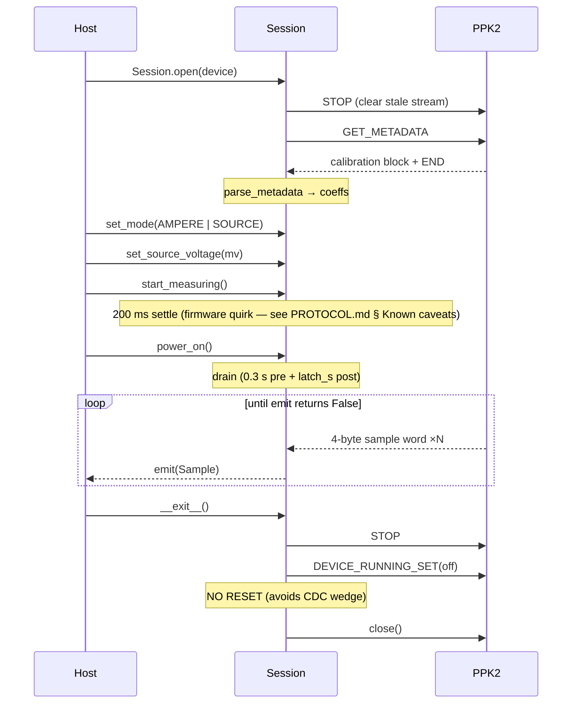

# Architecture

The `ppk2` package is built in three layers, each importable
on its own:

| Layer | Module | What |
|---|---|---|
| Protocol | `ppk2.protocol` | Pure wire-protocol primitives — opcodes, metadata parser, sample decoder, calibration formula, stream parser. Stdlib only. |
| Client | `ppk2.client` | Sync host driver on top of `pyserial`. Port discovery and the session state machine. |
| CLI | `ppk2.cli` | The `ppk2` binary, built on `typer`. Public surface is the binary; the Python module is implementation detail. |

The top-level package re-exports everyday names, so library
consumers can write:

```python
from ppk2 import (
    Session, Mode, find_ppk2,            # session
    Sample, StreamParser, parse_metadata,  # protocol
    CalibrationCoefficients, RawSample, current_micro_amps,
)
```

## Minimal example

A 5-second capture, integrating mean current as samples arrive:

```python
from ppk2 import Session, Mode, find_ppk2
from time import monotonic

DURATION_S = 5.0
n = 0
total_uA = 0.0
deadline = monotonic() + DURATION_S

def emit(s) -> bool:
    global n, total_uA
    n += 1
    total_uA += s.current_micro_amps
    return monotonic() < deadline

with Session.open(find_ppk2().device) as sess:
    sess.set_mode(Mode.AMPERE)
    sess.set_source_voltage(3300)   # ammeter mode: feeds the calibration VDD term (not a regulator setpoint)
    sess.start_measuring()
    sess.power_on()
    sess.capture(emit)

print(f"{n} samples, mean = {total_uA / n:.2f} µA")
```

The capture loop runs in the calling thread, and `emit`
returns `False` to stop. The `with` block's `__exit__` runs
the teardown (FET open + port close) even if `emit` raises —
your DUT isn't left drawing power because of a Python
exception.

## Session lifecycle



The 200 ms settle after `start_measuring()` and the drain
around `power_on()` (0.3 s pre-toggle + `latch_s`, default 1 s)
are both load-bearing — see [Protocol
notes](PROTOCOL.md) for why. `ppk2 capture` and
`ppk2 run` pass `latch_s=0.0`, which starts the trace at FET-on
so the DUT's boot inrush is captured.

## Threading model

One `Session` per thread. `pyserial`'s `Serial` isn't safe to
share by reference — concurrent reads and writes interleave on
the byte stream and produce decode garbage — and the session
layer deliberately doesn't add a lock on top.

You only need threads at all if you want a multi-consumer
fan-out, e.g. capturing to disk while also feeding a live
plotter. The natural pattern is a producer thread that owns the
session and pushes samples onto a queue; consumers read from
the queue:

```python
import threading, queue

from ppk2 import Session, Mode, find_ppk2

q: queue.Queue = queue.Queue(maxsize=10_000)

def producer():
    with Session.open(find_ppk2().device) as s:
        s.set_mode(Mode.AMPERE)
        s.start_measuring()
        s.power_on()
        s.capture(lambda sample: (q.put(sample), True)[-1])

t = threading.Thread(target=producer, daemon=True)
t.start()
# consumers drain `q` from any number of threads
```

`Sample` is a frozen dataclass, so consumers can share it
freely. The producer thread is the only one that touches the
session — that's the rule.

For a single-consumer capture (the typical case, including the
`ppk2 capture` CLI), no threads are involved. The `emit`
callback runs in the calling thread.

## See also

- `ppk2.protocol` — the wire-level layer.
- `ppk2.client` — discovery + session details.
- `ppk2 --help` is the subcommand reference.
