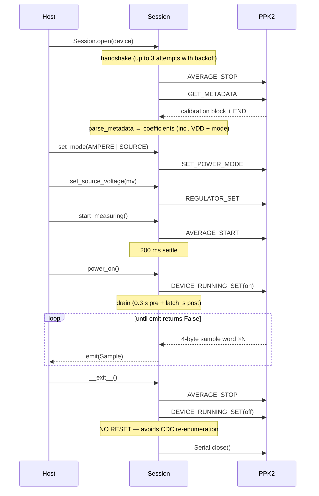

# PPK2 protocol notes

A reference description of the PPK2's wire protocol as this
package implements it: opcodes, sample frame layout, stream
reassembly logic, the calibration formula, the CSV output
format, and the gotchas worth knowing if you're implementing
against it. Source-of-truth code is
[`src/ppk2/protocol/`](../src/ppk2/protocol/); this
document is the human-readable narration around it.

## 1. What you're talking to

The PPK2 enumerates as **two USB CDC ACM interfaces** sharing
one USB serial number. Only one of them — the **data port** —
carries the 100 kSPS sample stream and answers protocol
commands; the other opens but stays silent and isn't used by
this library. The assignment isn't guaranteed by device-path
order, so discovery identifies the data port by probing with
`GET_METADATA`.

VID:PID is **`1915:c00a`** (Nordic Semiconductor's vendor ID +
the PPK2's product ID). Discovery filters on that pair. If
you're running a Nordic dev kit on the same bench, its embedded
J-Link reports under SEGGER's VID `0x1366` — that's a different
device.

A few practical notes:

- The nominal baud rate is `115_200`. USB CDC ACM ignores this
  for bulk transfers; it's there because pyserial wants a number.
- The kernel typically takes 1–3 seconds to enumerate both
  interfaces on cold plug. Discovery polls for up to 3 s before
  giving up.
- macOS's CDC stack can occasionally leave the port in a
  "wedged" state after a previous capture closed badly. The
  session layer's handshake handles that; if not, replug.

## 2. Opcodes

Each opcode is a single byte. If it takes a payload, the bytes
follow immediately.

| Byte | Name | Payload | Notes |
|---|---|---|---|
| `0x06` | `AVERAGE_START` | — | Begin the 100 kSPS stream |
| `0x07` | `AVERAGE_STOP` | — | End the stream (idempotent) |
| `0x0C` | `DEVICE_RUNNING_SET` | 1 byte: `0` off / `1` on | Toggle the DUT-power FET |
| `0x0D` | `REGULATOR_SET` | 2 bytes: big-endian mV (`0x0CE4 = 3300`) | Source-mode VDD; clamped 800–5000 mV |
| `0x11` | `SET_POWER_MODE` | 1 byte: `1` ammeter / `2` source | Must precede `AVERAGE_START` |
| `0x15` | `SPIKE_FILTERING_ON` | — | Firmware-side spike filter on (the default) |
| `0x16` | `SPIKE_FILTERING_OFF` | — | Firmware-side spike filter off |
| `0x19` | `GET_METADATA` | — | Request the per-device calibration block |
| `0x20` | `RESET` | — | Soft-reset. **Use sparingly** — see [Known caveats](#10-known-caveats). |
| `0x25` | `SET_USER_GAINS` | 1 byte range + 4 bytes float32 LE | Ignored by current firmware (bench-verified); we don't send it. |
| `0x02` | `AVG_NUM_SET` | 4 bytes | Dead in firmware (silently ignored). |

Opcodes related to the trigger-mode protocol (`TRIGGER_*`,
`SWITCH_POINT_*`, `LCD_SET`, `RANGE_SET`) exist in Nordic's
constants table but aren't used by this library — sampling mode
is its own protocol.

## 3. Metadata response

`GET_METADATA` returns a small text-form block of `key: value`
lines terminated by a literal `END`. Each per-range coefficient
is its **own indexed key** (`R0` … `R4`, `GS0` … `UG4`), one per
line, in fixed-point decimal. Example from a real capture
([`tests/fixtures/metadata.raw`](../tests/fixtures/metadata.raw)), trimmed:

```text
Calibrated: 0
R0: 1002.11859130859380000000
R1: 101.47830963134766000000
R2: 10.33613014221191400000
R3: 0.96828395128250120000
R4: 0.05643343180418014500
GS0: 0.00000000000000000010
...
VDD: 3300
HW: 46575
mode: 1
IA: 60
END
```

The wire format has no length prefix, so the receiver has to
accumulate bytes until it sees `END`. Pyserial sometimes splits
that across two reads. The parser handles both: feed it
whatever you've accumulated so far, and it'll either parse or
raise.

Parsing rules:

1. UTF-8 decode the buffer with `errors="replace"` — binary
   sample-stream residue from a badly shut-down prior session can
   precede the ASCII block, and it decodes into garbage lines the
   scanner skips rather than failing the whole parse.
2. Split on newlines, ignore blanks, split each line on the
   first colon.
3. The seven per-range arrays (`R`, `GS`, `GI`, `O`, `S`, `I`,
   `UG`) arrive as 35 indexed keys — `R0` … `R4`, `GS0` … `GS4`,
   … `UG0` … `UG4` — one float per line. The parser splits the
   trailing digit off the key to slot the value into the right
   range index.
4. The scalars are `Calibrated` (0/1 → bool), `HW`, `IA`,
   `VDD` (millivolts), and `mode` (1 = ammeter, 2 = source).
5. Missing calibration fields raise `MissingField`; unparseable
   values raise `InvalidValue`, and so do values that parse as
   floats but are non-finite — real devices emit `-nan` for
   blank calibration slots, and accepting one would poison every
   downstream current computation. Unknown keys are dropped
   silently (forward-compat).

`VDD` and `mode` are runtime state, not calibration — they
survive across host disconnects, so the next session opens with
the firmware already configured to whatever the last one left
behind. `Session.open` seeds itself from them. Because they're
runtime state, they're also the only two keys allowed to be
absent: some firmware revisions omit them, and the parser then
defaults to 3300 mV / mode 1 (ammeter) instead of failing.

The full response is typically ~1 KB (the captured fixture is 1 032 bytes).

## 4. Sample frame

Each sample is a 4-byte little-endian word with this layout:

```text
bit  31      24 23     18 17  16 14 13       0
    ┌──────────┬──────────┬──┬─────┬────────────┐
    │   LOGIC  │ COUNTER  │R │RANGE│    ADC     │
    └──────────┴──────────┴──┴─────┴────────────┘
       D0..D7   6-bit cnt  res 3-bit  14-bit
```

| Field | Bits | Meaning |
|---|---|---|
| `ADC` | 0–13 | 14-bit raw ADC reading. Multiply by 4 to get a 16-bit-equivalent value before the calibration formula. |
| `RANGE` | 14–16 | Auto-range selector. Valid values are 0–4. Anything ≥ 5 means the parser slid out of alignment. |
| reserved | 17 | Always 0. Don't assert on it. |
| `COUNTER` | 18–23 | 6-bit per-sample counter, mod 64. Monotonic; gaps are the stream-reassembly hook. |
| `LOGIC` | 24–31 | D0–D7 digital input pins packed into one byte. Bit 0 = D0. |

Bit extraction lives in `ppk2.protocol.decode_sample` — a few
mask-and-shift operations, nothing surprising.

## 5. Stream reassembly

USB CDC delivers a byte stream, not framed packets. The parser
has to handle three concerns:

**Stay aligned.** Sample words are 4 bytes; reads aren't
guaranteed to land on 4-byte boundaries (though in practice on
macOS they always do). The parser keeps a small remainder
buffer of any trailing 1–3 bytes and prepends them to the next
chunk.

**Validate per-word.** A `RANGE` value above 4 means we're
reading at the wrong byte offset. Drop that word and let the
next one resync.

**Track the counter.** The 6-bit counter increments by one for
each sample the firmware emits, mod 64. If the host falls behind
or the bus blips, the next byte we see might have a counter
that's ahead of where we expected. The parser maintains a small
buffer of "mismatched" samples and a recovery state machine:

- **In sync** — emit the sample. If there are pending mismatched
  samples buffered, drain them first; they were real samples,
  just delivered behind a brief gap.
- **Mismatch with room in the buffer** — buffer the sample,
  advance the expected counter, and wait. If the next few
  samples bring the counter back into sync, drain.
- **Buffer full** — with 5 mismatches already buffered, the
  arrival of a 6th consecutive mismatch declares data loss. Emit
  NaN placeholders covering the gap between expected and
  observed counters (so the timeline length stays right), drop
  the buffered samples (they were probably garbage), and resync
  to the new counter.

NaN placeholders surface as `Sample(current_micro_amps=nan,
logic=0)` in the library. The CLI's CSV writer skips NaN rows
when writing — same as the Nordic GUI's export does. On a clean
bus they never appear; under contention or bad cabling, the
end-of-capture stderr line reports how many were skipped.

The EMA spike filter runs on every counter-tracked input sample
regardless of whether it ends up emitted or buffered — that
matches the Nordic ordering and keeps buffered samples' smoothed
values consistent with the timeline. Range-invalid words are the
exception: they're dropped *before* calibration, so they never
touch the EMA state. See [Spike filter](#7-spike-filter) for the
constants.

## 6. Calibration formula

The per-sample math — turning a 14-bit ADC reading + a range
index + the present VDD into a microamp value — lives in
[`src/ppk2/protocol/calibration.py`](../src/ppk2/protocol/calibration.py)
(`current_micro_amps`). It
is stateless, matches Nordic's `getAdcResult` term-for-term,
and consumes the seven per-range coefficient arrays from the
metadata block (`R`, `GS`, `GI`, `O`, `S`, `I`, `UG`), indexed
by the sample's 3-bit range `r`. Three steps:

**Step 1 — offset and scale.** Rescale the 14-bit ADC value to
its 16-bit equivalent, subtract the per-range offset `O[r]`,
and scale by a fixed ADC constant over the per-range resistance
`R[r]`:

```text
adc_16 = adc_14 * 4
x      = (adc_16 - O[r]) * ((1.8 / 163840) / R[r])
```

`1.8` is the ADC reference voltage; `163840 = 2^14 × 10` is the
firmware's scaling base (post-decimation 14-bit ADC, then ×10
internal headroom).

**Step 2 — gain correction.** Apply the per-range quadratic
gain polynomial, the VDD-dependent linear term (`vdd` in
volts), and the per-range user gain `UG[r]`:

```text
corrected = UG[r] * ( x * (GS[r] * x + GI[r]) + S[r] * vdd + I[r] )
```

**Step 3 — unit conversion.** `corrected` is in amperes;
multiply by `1e6` for microamps:

```text
current_micro_amps = corrected * 1e6
```

### Worked example

With `adc_14 = 151`, `range = 0`, `vdd_mv = 3300`, and the
range-0 coefficients from the captured fixture
([`tests/fixtures/metadata.raw`](../tests/fixtures/metadata.raw)):

| Coefficient | Value |
|---|---|
| `R0` | `1002.1185913085938` |
| `O0` | `122.94572448730469` |
| `GS0` | `1e-19` |
| `GI0` | `1.0` |
| `S0` | `-7.04615787939e-09` |
| `I0` | `5.155071036711e-08` |
| `UG0` | `1.0` |

```text
step 1: adc_16 = 151 * 4 = 604
        x = (604 - 122.94572448730469) * ((1.8 / 163840) / 1002.1185913085938)
          = 5.2738469903200775e-06
step 2: corrected = 1.0 * (x * (1e-19 * x + 1.0)
                           + (-7.04615787939e-09 * 3.3)
                           + 5.155071036711e-08)
          = 5.3021453796852005e-06        # amperes
step 3: current_micro_amps = 5.302145379685201 µA
```

That exact result is regression-pinned by
[`tests/protocol/test_calibration.py`](../tests/protocol/test_calibration.py)
against
[`tests/fixtures/metadata.raw`](../tests/fixtures/metadata.raw).

## 7. Spike filter

A two-stage exponential moving average runs inside the stream
parser, smoothing the residual ADC noise:

- **Ranges 0–3.** α ≈ 0.18; settles in ~16 samples.
- **Range 4.** α ≈ 0.06; settles over hundreds of samples (the
  slower coefficient compensates for range 4's wider noise
  spread).

When the transition lands on range 4, the first 2 samples feed
through a rollback path (the EMAs are restored to their
pre-update values) so the slow EMA doesn't lag the new range;
transitions onto ranges 0–3 have no rollback.

The filter is on by default, both firmware-side (`SPIKE_FILTERING_ON`)
and host-side (the EMA above). There is deliberately no CLI knob
to disable it: GUI-parity output is the product contract.

## 8. Modes

| Mode | `SET_POWER_MODE` payload | Behaviour |
|---|---|---|
| Ampere | `0x01` | PPK2 sits in series with externally-supplied VCC. FET passes current through; PPK2 measures it. |
| Source | `0x02` | PPK2 supplies VCC at the `REGULATOR_SET` setpoint. |

`SET_POWER_MODE` is only accepted while no sample stream is
active. Call it before `AVERAGE_START`; during a stream the
firmware silently drops it.

## 9. Session lifecycle



The 200 ms settle after `AVERAGE_START` and the drain around
`DEVICE_RUNNING_SET(on)` (0.3 s before the toggle, `latch_s` —
default 1 s — after) are both load-bearing — see [Known
caveats](#10-known-caveats) for what breaks without them.

## 10. Known caveats

- **macOS CDC wedge.** A previous capture can leave the CDC
  port stuck so the next open's metadata read times out. The
  session layer retries the open three times, sleeping 0.5 s
  then 1.0 s between attempts, which clears most wedges. If it
  doesn't, unplug and replug.

- **Post-session unresponsive window.** For up to ~a minute after
  any session ends (clean close or killed process), the firmware
  stops answering `GET_METADATA` until reset, and right after a
  kill the CDC driver can refuse opens for a second or two.
  Discovery handles both: when the quick probe finds no data
  port, it escalates to a recovery probe — stop + `RESET`, ride
  out the re-enumeration, reopen with retry, query with the
  session budget (`probe_port_recover`).

- **`RESET` (`0x20`) is a trap on close.** It triggers a
  ~200–500 ms USB CDC re-enumeration on macOS and frequently
  wedges the next session worse than leaving the port "stale"
  does. The Nordic GUI never sends `RESET` at any point (open,
  close, or recovery) and works fine without it. This library
  sends it in exactly two places, both of which stay around to
  absorb the re-enumeration: a *failed* handshake retry attempt,
  and discovery's recovery probe (which closes, waits out the
  re-enum, and reopens with retry).

- **`AVG_NUM_SET` (`0x02`) is dead in firmware.** Both Nordic's
  GUI and IRNAS's Python lib forward it; the PPK2 firmware
  silently ignores it. The "sample rate slider" in the Nordic
  GUI is host-side decimation, not a wire-level rate change.
  See the decimation notes in
  [`src/ppk2/cli/csv.py`](../src/ppk2/cli/csv.py).

- **`SET_USER_GAINS` (`0x25`) is dead on current firmware.** The
  opcode is accepted without error but provably ignored:
  a 5× gain write produced no shift in sample values, and a
  2026-07-11 retest with the GUI's exact frame format showed the
  metadata `UG` block unchanged after a write and the stream
  undisturbed (pre-stream burst and mid-stream single frame
  alike). Nordic's GUI applies user gain host-side and so do we —
  `Session.set_user_gain` issues no wire write at all.

- **The counter is 6 bits, not 2.** IRNAS's older code masked
  with `& 0x03` — that masks out 4 of the 6 bits and produces a
  "valid" counter on every frame, hiding real misalignments. Use
  the full 6 bits (`& 0x3F`).

- **The metadata response can split across reads.** No length
  prefix; the receiver has to accumulate until `END` shows up.

- **`AVERAGE_START` has a settle window.** `DEVICE_RUNNING_SET`
  sent during the ~150 ms after `AVERAGE_START` is silently
  dropped by the firmware. The session layer waits 200 ms
  unconditionally.

- **The original PPK (non-2) reports different USB PIDs.** This
  library accepts only `1915:c00a` (PPK2); the older PPK runs a
  different wire protocol and is out of scope.

## 11. CSV format

`ppk2 capture` writes a CSV that is **byte-format-identical to
the Nordic Power Profiler GUI's export** — same 11 columns,
same timestamp formatting, same per-pin logic columns. Bytes
out of either tool are diffable.

### Schema

```csv
Timestamp(ms),Current(uA),D0-D7,D0,D1,D2,D3,D4,D5,D6,D7
0,3.451,00000000,0,0,0,0,0,0,0,0
0.01,3.221,00000000,0,0,0,0,0,0,0,0
0.02,3.598,10000000,1,0,0,0,0,0,0,0
```

| Column | Type | Notes |
|---|---|---|
| `Timestamp(ms)` | trimmed float | Milliseconds since capture start, with trailing zeros and the trailing decimal point stripped: `0`, `0.01`, `0.1`, `10`, `1000`. Computed from the sample index, not wall-clock time — adjacent rows are exactly 10 µs apart. |
| `Current(uA)` | three decimals | Calibrated current in microamps. Post-spike-filter (see the spike-filter notes above). |
| `D0-D7` | 8-char bit string | One character per pin. **D0 is leftmost**: `"10000000"` means D0 high, D1–D7 low. |
| `D0` … `D7` | `0` or `1` per cell | Individual pin columns — redundant with `D0-D7`, but easier when you want column-oriented analysis (e.g. `df["D0"]` in pandas). |

### Why this exact format

The choices aren't arbitrary — they match the Nordic Power
Profiler GUI's `Save / Export` output byte-for-byte, which buys
you three things:

- **Cross-validation works directly.** Capture once with this
  CLI and once with the GUI on the same DUT, then diff the
  files. The
  [`validation/compare_cli.py`](../validation/compare_cli.py)
  script automates the body comparison.
- **A/B comparison is trustworthy.** A baseline captured before
  anyone wrote this CLI (say, by a colleague who used the GUI)
  compares correctly against a fresh capture from this CLI.
- **Existing tooling just works.** Anything that ingests the
  GUI's export ingests this CLI's output without modification.

### Sizing

At 100 kSPS, the CSV is roughly **40 bytes per row**:

| Duration | Rows | CSV size |
|---:|---:|---:|
| 1 s | 100 k | ~4 MB |
| 1 min | 6 M | ~240 MB |
| 1 hour | 360 M | ~14 GB |
| 8 hours | 2.88 G | ~115 GB |

### Data-loss placeholders

The stream parser emits a `NaN` placeholder for samples it
can't decode (a brief burst of bus noise that overflows the
corruption buffer — see §5 Stream reassembly above).
`ppk2 capture` skips those rows when writing but still advances
the timestamp, matching the Nordic GUI: missing samples appear
as gaps in the timestamp column, not as empty rows. On a clean
bench this never happens; when it does, the end-of-capture
stderr summary says how many rows were skipped.

### Noise floor

Every calibrated value below 0.2 µA — negative noise included —
is written as exactly `0.000`, matching the GUI's ingestion clamp
("PPK 2 can only read till 200nA", the GUI's own source comment).
The stderr summary uses the same clamped values, so the file and
the summary agree. Data-loss placeholders are unaffected — they
still write no row.

When diffing against a GUI export, one scope note: the GUI's bit
columns use a four-state alphabet (`-`, `0`, `1`, `X`) whose extra
states appear only in decimated/averaged exports. At raw
100 kSPS the GUI emits plain `0`/`1`, same as this CLI.

### Reading recipes

#### Just the current trace (numpy)

```python
import numpy as np

ua = np.loadtxt("capture.csv", delimiter=",", skiprows=1, usecols=1)
print(f"n={len(ua)}, mean={ua.mean():.2f} µA")
```

#### Current + timestamp

```python
ts, ua = np.loadtxt(
    "capture.csv", delimiter=",", skiprows=1, usecols=(0, 1), unpack=True
)
```

#### Current + all logic pins (pandas)

```python
import pandas as pd

df = pd.read_csv("capture.csv")
print(df.head())
print(df.describe())
print(df[df["D0"] == 1].shape[0], "samples with D0 high")
```

#### Bit string → individual pin (numpy)

If you only have the `D0-D7` column for some reason:

```python
d07 = df["D0-D7"].astype(str)
d0 = d07.str[0].astype(int)         # D0 is the leftmost char
d3 = d07.str[3].astype(int)
```

The `D0` … `D7` columns are computed from `D0-D7` at capture
time, so they're already there for free; don't extract from the
string unless you're working from a partial CSV.

## 12. References

The protocol decisions in this chapter are cross-checked
against two reference implementations:

- **Nordic's GUI** — [`pc-nrfconnect-ppk`](https://github.com/NordicSemiconductor/pc-nrfconnect-ppk)
  at SHA `63ae4b7`. The canonical source for opcode semantics
  and the host-side spike filter.
- **IRNAS's Python lib** — [`ppk2-api-python`](https://github.com/IRNAS/ppk2-api-python)
  at `9894072` (v0.9.2). The reference Python implementation
  this project diverges from cleanly.

For where each claim in this chapter sits in our code, read
[`src/ppk2/protocol/`](../src/ppk2/protocol/).
