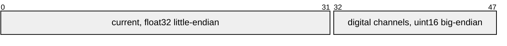

# File formats

`ppk2` writes the two formats of the Power Profiler app: the CSV the
app exports, and the `.ppk2` session file it saves and loads. A name
ending in `.ppk2` gives a session file, any other name a CSV.

## CSV

`ppk2 capture` writes the same file as the app's export at the full
sample rate, to the character: the same 11 columns, the same way of
writing timestamps, the same digital columns.

```csv
Timestamp(ms),Current(uA),D0-D7,D0,D1,D2,D3,D4,D5,D6,D7
0,3.451,00000000,0,0,0,0,0,0,0,0
0.01,3.221,00000000,0,0,0,0,0,0,0,0
0.02,3.598,10000000,1,0,0,0,0,0,0,0
```

| Column | Content |
|---|---|
| `Timestamp(ms)` | Milliseconds from the first sample. Trailing zeros are removed: `0`, `0.01`, `0.1`, `10`, `1000` |
| `Current(uA)` | Microamperes, three decimals, after the spike filter |
| `D0-D7` | The eight digital inputs as eight characters, D0 first: `10000000` is D0 high and the others low |
| `D0` to `D7` | The same inputs, one column each, `0` or `1` |

The timestamp is computed from the number of the sample, not from a
clock: rows are exactly 0.01 ms apart.

!!! warning "D0 is the leftmost character"

    In the `D0-D7` field the first character is D0. In the library,
    `Sample.logic` is a number in which D0 is bit 0. The two look alike
    and read in opposite directions.

What else to know:

- A lost sample has no row. The timestamp of the next row skips its
  place, as in the app's export, so the time axis stays right.
- A value below 0.2 µA is written as `0.000`, as in the app.
- When the app exports at a lower sample rate, its digital columns can
  also hold `-` and `X`. At the full rate both tools write only `0` and
  `1`.
- A row is about 40 bytes. One minute is 240 MB and one hour 14 GB.

This format was chosen because it is the app's. A capture made here and
one exported from the app can be compared directly, which is what the
[validation](../validation/method.md) does, and whatever reads the
app's export reads this.

### Reading it

The current only, with numpy:

```python
import numpy as np

ua = np.loadtxt("capture.csv", delimiter=",", skiprows=1, usecols=1)
print(f"{len(ua)} samples, mean {ua.mean():.2f} µA")
```

Everything, with pandas:

```python
import pandas as pd

df = pd.read_csv("capture.csv", dtype={"D0-D7": str})
print((df["D0"] == 1).sum(), "samples with D0 high")
```

Pass `dtype={"D0-D7": str}`. Without it pandas reads `00000001` as the
number 1 and the leading zeros are gone. A gzipped file reads the same
way: both libraries open `capture.csv.gz` directly.

## Session file (`.ppk2`)

A `.ppk2` file is what the app writes with Save / Export and loads
again. `ppk2 capture --out x.ppk2` and `ppk2 convert` write this
format, so that a capture made from a script can be looked at in the
app's chart.

It is a zip of three files:

| File | Content |
|---|---|
| `session.raw` | The samples, 6 bytes each |
| `minimap.raw` | JSON: the lowest and highest value of the trace over at most 10,000 intervals. The app draws its overview from it |
| `metadata.json` | The sample rate and the version of the format, 2 |

One sample in `session.raw`:



| Field | Bytes | Content |
|---|---|---|
| Current | 0 to 3 | Microamperes, a 32-bit float, little-endian. A lost sample is NaN |
| Digital channels | 4 and 5 | Two bits per channel, big-endian: `01` low, `10` high. D0 is in the lowest pair |

`ppk2` writes a current below 0.2 µA as zero, which is how the app
reads it. `metadata.json` of a capture at the full rate:

```json
{"metadata": {"samplesPerSecond": 100000}, "formatVersion": 2}
```

The sample rate is a power of ten from 1 to 100,000. `ppk2 convert`
reads it from the timestamps of the CSV.

### How far this is checked

The layout comes from the README of the app's repository and from its
source at v4.4.1. Unit tests check what `ppk2` writes against that
layout: the three files, the bytes of a sample, the overview, the
handling of lost samples.

One of these files has not yet been opened in the app itself. Until
that is done, treat the format as written to the description and not as
proven to load. Nordic gives no guarantee that the format stays the
same between versions of the app.

### Size, and how it is written

A capture of 5.1 s on the bench of this repository took 0.7 MB as a
session file and 20.5 MB as a CSV. The file is compressed, so a noisier
signal takes more.

While a capture runs, the samples go to a file next to the output,
named after it with `.frames` added, 6 bytes per sample. At the end the
session file is built from it and put in place in one step. If that
fails, the `.frames` file stays, and an earlier session file of the
same name is left untouched. A capture without a single sample writes
no file.
