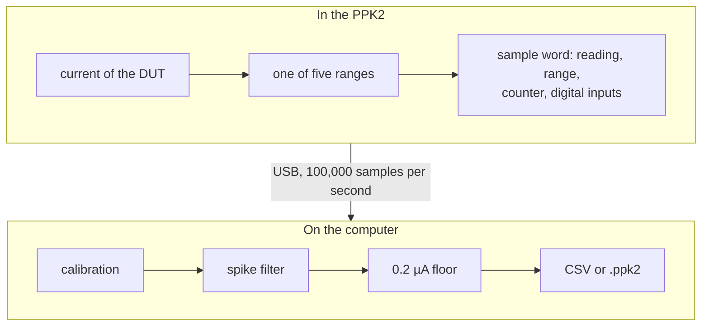

# Measurement principle

How a current at the DUT becomes a number in a file. This page follows
one sample from the PPK2 to the CSV.



The PPK2 sends raw readings. Everything after the USB cable is done by
this package, in the same way as Nordic's Power Profiler app does it.

## What is measured

The current that flows through the PPK2, 100,000 times per second, and
with each sample the state of eight digital inputs. The PPK2 does not
measure voltage.

| Mode | Where the PPK2 sits | Supply voltage |
|---|---|---|
| Ampere meter | In series between a supply and the DUT | Whatever the supply gives. The PPK2 must be told |
| Source meter | It is the supply | Set by the PPK2, 0.8 to 5.0 V |

## Five measurement ranges

The PPK2 covers 200 nA to 1 A with five ranges and switches between
them by itself as the current moves. From the PPK2 user guide:

| Range in the app | Range in the stream | Span | Resolution |
|---:|---:|---|---:|
| 1 | 0 | 200 nA to 50 µA | 0.2 µA |
| 2 | 1 | 50 µA to 500 µA | 0.5 µA |
| 3 | 2 | 500 µA to 5 mA | 5 µA |
| 4 | 3 | 5 mA to 50 mA | 50 µA |
| 5 | 4 | 50 mA to 1 A | 1 mA |

The app and the user guide number the ranges 1 to 5. The PPK2's stream
numbers them 0 to 4, and so does this package, in `--user-gain`, in
`Session.set_user_gain` and in the calibration arrays.

There is no setting for where the PPK2 switches. Nordic's command list
has `SWITCH_POINT_DOWN` and `SWITCH_POINT_UP`; the app does not send
them and neither does this package.

Each sample says which range it was taken in. The range is in the
stream, not in the CSV. To see it, decode the words:

```python
from pathlib import Path

from ppk2 import decode_sample_bytes

stream = Path("tests/fixtures/stream_poweron.bin").read_bytes()
ranges = [decode_sample_bytes(stream[i : i + 4]).range for i in range(0, len(stream), 4)]
changes = sum(a != b for a, b in zip(ranges, ranges[1:]))
print(f"{len(ranges)} samples, {changes} range changes, ranges {sorted(set(ranges))}")
```

```text
600 samples, 9 range changes, ranges [0, 1, 2, 3, 4]
```

That file is 6 ms of a dev kit being powered on: the current climbs
through all five ranges.

## From a reading to a current

Every PPK2 carries its own calibration and sends it as text when asked.
`ppk2 metadata` prints it; in Python it is what `Session.coefficients()`
returns.

### What the PPK2 reports

Seven arrays of five values, one value per range:

| Name | Role in the formula |
|---|---|
| `R` | Resistance of the range, in ohms |
| `O` | Offset of the reading |
| `GS` | Gain, quadratic term |
| `GI` | Gain, linear term |
| `S` | Dependence on the supply voltage, slope |
| `I` | Dependence on the supply voltage, constant |
| `UG` | User gain, 1.0 unless changed |

And five single values:

| Name | Meaning |
|---|---|
| `Calibrated` | 0 or 1. See below |
| `VDD` | The supply voltage the PPK2 was left at, in millivolts |
| `mode` | The mode it was left in: 1 Ampere meter, 2 Source meter |
| `HW`, `IA` | Whole numbers, reported as they come. This package does not interpret them |

The parser requires every one of these except `VDD` and `mode`. Without
them it assumes 3300 mV and Ampere meter mode.

A PPK2 can leave a slot of an array blank, which it prints as `-nan`.
The parser then takes the value the app assumes: the nominal
resistance for `R` (1031.64, 101.65, 10.15, 0.94 and 0.043 Ω), 1 for
the gains and 0 for the rest.

### The `Calibrated` flag

```text
Calibrated: false
```

This line makes people think their PPK2 is faulty. It is not a fault.
The PPK2 used for every measurement in this documentation reports it,
and its captures agree with the app's on the same bench. Nothing in the
app's source reads this value, and this package only stores it.

To check a PPK2, compare it with the app on the same DUT, as the
[validation](../validation/method.md) does.

### The formula

For a reading `adc` taken in range `r`, at a supply voltage `vdd` in
volts:

```text
x  = (adc * 4 - O[r]) * ((1.8 / 163840) / R[r])
uA = UG[r] * (x * (GS[r] * x + GI[r]) + S[r] * vdd + I[r]) * 1e6
```

`x` is the current in amperes before correction. 1.8 V is the reference
of the converter and 163840 is 2^14 × 10. The second line corrects the
gain, adds the part that depends on the supply voltage, and applies the
user gain. This is the formula of the app. In Python it is
[`current_micro_amps`](../develop/api.md#ppk2.protocol.calibration.current_micro_amps).

The sample word `0x015c0097` decodes to a reading of 151 in range 0,
with counter 23 and D0 high. With the range 0 values of the PPK2
measured here, at 3300 mV:

```text
R[0]  = 1002.1185913085938
O[0]  = 122.94572448730469
GS[0] = 1e-19
GI[0] = 1.0
S[0]  = -7.04615787939e-09
I[0]  = 5.155071036711e-08
UG[0] = 1.0

x  = (604 - 122.94572448730469) * ((1.8 / 163840) / 1002.1185913085938)
   = 5.2738469903200775e-06
uA = 5.302145379685201
```

### Why the supply voltage matters

The formula has a term in `vdd`. In Source meter mode the PPK2 knows
the voltage, since it supplies it. In Ampere meter mode it does not:
`--vdd`, or `set_source_voltage` in Python, tells it. That is why the
option exists in both modes.

How much a wrong value costs depends on the range. On the PPK2
measured here, an error of 0.3 V shifts the result by:

| Range in the stream | Shift |
|---:|---:|
| 0 | 2 nA |
| 1 | 16 nA |
| 2 | 0.15 µA |
| 3 | 2.8 µA |
| 4 | 0.72 mA |

At sleep currents it does not matter. Above a few milliamperes it
does: give the voltage the DUT really runs at.

### User gain

`UG` multiplies the result of one range. It is 1.0 on the PPK2 measured
here. [`Session.set_user_gain`](../develop/architecture.md#gains) and
`--user-gain` change it for one session, on the computer only.

## After a range change: the spike filter

The first readings after a range change can be far too high. The spike
filter replaces them. It is the app's filter, with the app's defaults.

It is not a general smoother. It acts only around a range change:

- Two running averages follow all readings, a quick one and a heavier
  one.
- From each range change on, three readings are replaced by an
  average. The reading at the change is the first of the three.
- In the top range the heavier average is used, and the first two
  readings after the change are also kept out of both averages.
- Every other reading passes through unchanged.

On the 600 samples above, with their nine range changes:

| | Mean | Highest reading |
|---|---:|---:|
| With the filter | 5,205.55 µA | 127 mA |
| Without it | 5,907.45 µA | 288 mA |

The filter changed 23 of the 600 samples, and without it the mean reads
13.5 % higher. A tool that leaves the filter off does not measure the
same thing as the app.

| Setting in the app | Here | Default | Allowed |
|---|---|---:|---|
| Samples to smooth | `samples` | 3 | 0 or more |
| Coefficient for range 1-4 | `alpha` | 0.18 | 0 to 1 |
| Coefficient for range 5 | `alpha5` | 0.06 | 0 to 1 |

A smaller coefficient is a heavier average.
[`Session.set_spike_filter`](../develop/architecture.md#settings-of-a-session)
changes the three numbers. The command line has no option for this, on
purpose: a file written by `ppk2 capture` always uses the app's
defaults.

`samples=0` does not switch the filter off. The reading at each range
change is still replaced: 9 of the 600 samples above. To see what the
PPK2 really sent, decode the words yourself and skip the stream parser:

```python
from pathlib import Path

from ppk2 import current_micro_amps, decode_sample_bytes, parse_metadata

coeffs = parse_metadata(Path("tests/fixtures/metadata.raw").read_bytes())
stream = Path("tests/fixtures/stream_poweron.bin").read_bytes()

currents = []
for i in range(0, len(stream), 4):
    word = decode_sample_bytes(stream[i : i + 4])
    currents.append(current_micro_amps(word.adc_14, word.range, 3300, coeffs))
print(f"{len(currents)} readings, mean {sum(currents) / len(currents):.2f} µA")
```

```text
600 readings, mean 5907.45 µA
```

Nordic's command list also has `SPIKE_FILTERING_ON` and
`SPIKE_FILTERING_OFF`, for a filter inside the PPK2. The app does not
send either, and neither does this package.

## The floor

A value below 0.2 µA, negative noise included, becomes 0. The app does
the same when it receives a sample, with the comment "PPK 2 can only
read till 200nA". `ppk2 capture` applies it before it writes the file
and before it computes the mean it prints, so the two agree.

## Time

The sample count is the clock. One sample lasts 10 µs, and the
timestamp of a row is its number times 0.01 ms. No computer clock is
involved, so rows are exactly 10 µs apart.

- A lost sample keeps its place. Each sample carries a counter; when
  the counter jumps, the parser puts a placeholder where each missing
  sample was. The trace keeps its true length, and the
  [protocol page](protocol.md#5-putting-the-stream-back-together) says
  how.
- The rate is fixed. The PPK2 has no command that makes it send fewer
  samples: its firmware ignores `AVG_NUM_SET`. When the app shows fewer
  samples per second, it has averaged blocks of samples on the
  computer. `ppk2 capture` always writes the full rate.
- A capture starts about 10 ms before the DUT is powered. The
  [known caveats](protocol.md#10-known-caveats) explain why.

## Digital inputs

The eight inputs of the logic port are read at the same instants as the
current, and travel in the same sample word. That is what allows a
[marked region](../user/recipes.md#current-of-a-marked-region) of code to
be measured exactly.

- In the library, `Sample.logic` is a number in which D0 is bit 0. In
  the CSV's `D0-D7` field, D0 is the leftmost character.
- The PPK2 tells high from low against the voltage on the logic port's
  `VCC` pin, which Nordic specifies from 1.65 to 5.5 V.
- Nordic gives the inputs a typical bandwidth of 50 kHz. A pulse
  shorter than 10 µs can be missed.
- While the DUT is unpowered, the inputs can read high.

## Accuracy

The accuracy is the PPK2's. Nordic's user guide gives ±10 % on the
average value in ranges 1 to 4 and ±15 % in range 5, as typical
figures, and "better than ±20 %" overall.

This package neither improves nor measures that. What it aims at is
narrower: from the same samples, the same numbers as the app. The
[validation](../validation/method.md) shows how that is checked.
