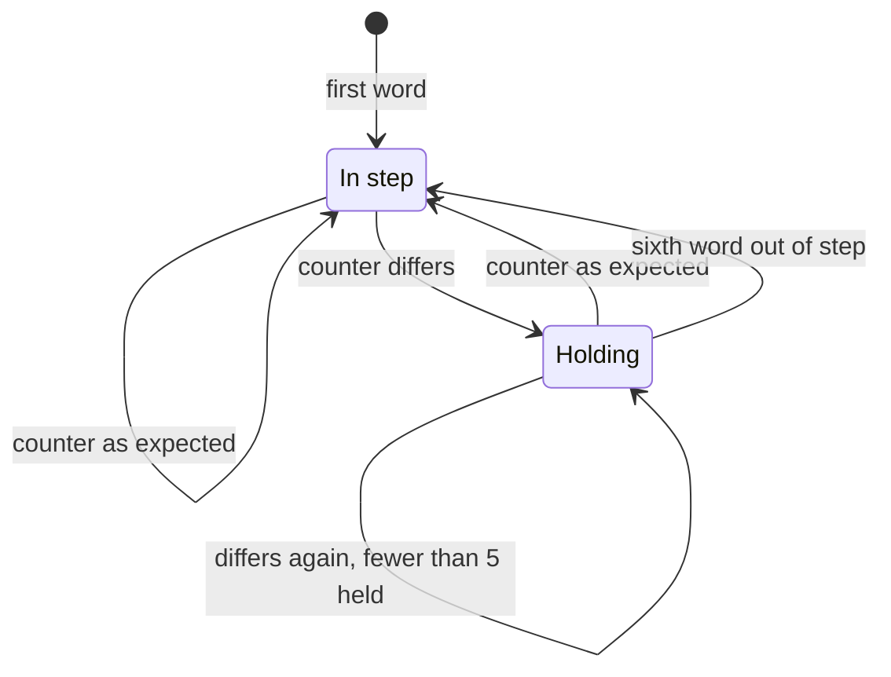
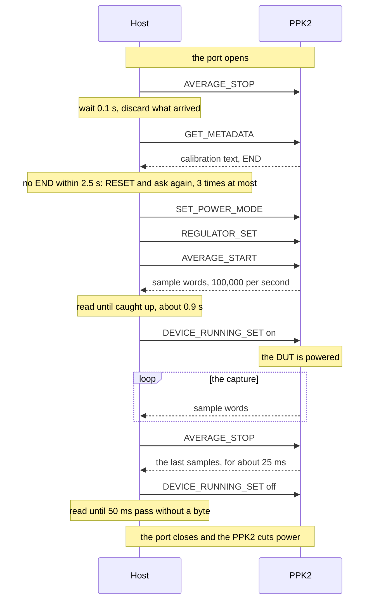

# PPK2 protocol

How a computer talks to a PPK2, as this package does it. The page
covers two things:

- the encoding: which bytes mean what, in the commands, the calibration
  text and the samples;
- the behaviour: what the PPK2 does, in what order a session goes, how
  the stream is put back together, and where the PPK2 does something
  you might not expect.

| Encoding | Behaviour |
|---|---|
| [2. Commands](#2-commands) | [1. The device](#1-the-device) |
| [3. Calibration text](#3-calibration-text) | [5. Stream reassembly](#5-stream-reassembly) |
| [4. Sample word](#4-sample-word) | [7. Spike filter](#7-spike-filter) |
| [6. Calibration formula](#6-calibration-formula) | [8. Modes](#8-modes) |
| | [9. Session sequence](#9-session-sequence) |
| | [10. Known caveats](#10-known-caveats) |

The code is in
[`src/ppk2/protocol/`](https://github.com/rdagher/ppk2-lib/tree/main/src/ppk2/protocol)
for the bytes and in
[`src/ppk2/client/session.py`](https://github.com/rdagher/ppk2-lib/blob/main/src/ppk2/client/session.py)
for the order of things. The file formats `ppk2` writes are not part of
the protocol: see [file formats](formats.md) for them.

## 1. The device

A PPK2 shows up as two USB serial ports with the same USB serial
number, VID:PID `1915:C00A`. Only one of them, the data port, carries
the samples and answers commands. The other opens and stays silent.
Their order is not fixed, so discovery finds the data port by asking
each one for its calibration.

- The baud rate does not matter over USB. This package sets `115200`
  because [pyserial](https://pyserial.readthedocs.io/) wants a number.
- After plugging in, both ports can take 1 to 3 seconds to appear.
  Discovery polls for up to 3 s.
- A Nordic dev kit on the same bench shows its debugger under SEGGER's
  VID `1366`. That is another device.

What the PPK2 does, in short:

- It answers `GET_METADATA` with its calibration and the settings it
  was left with.
- After `AVERAGE_START` it sends 100,000 sample words per second until
  `AVERAGE_STOP`, whether or not anyone reads them.
- It keeps its supply voltage and its mode when the computer
  disconnects.
- It cuts power to the device under test (DUT) when the serial port
  closes.

## 2. Commands

A command is one byte, followed by its payload if it has one.

| Byte | Name | Payload | Effect |
|---|---|---|---|
| `0x06` | `AVERAGE_START` | none | Start the stream, 100,000 samples per second |
| `0x07` | `AVERAGE_STOP` | none | Stop the stream |
| `0x0C` | `DEVICE_RUNNING_SET` | 1 byte: `0` off, `1` on | Power to the DUT. The app's Enable power output |
| `0x0D` | `REGULATOR_SET` | 2 bytes: millivolts, high byte first | Supply voltage in Source meter mode, 800 to 5,000 mV |
| `0x11` | `SET_POWER_MODE` | 1 byte: `1` Ampere meter, `2` Source meter | Choose the mode |
| `0x15` | `SPIKE_FILTERING_ON` | none | Not sent, by the app or by this package |
| `0x16` | `SPIKE_FILTERING_OFF` | none | Not sent either |
| `0x19` | `GET_METADATA` | none | Ask for the calibration text |
| `0x20` | `RESET` | none | Restart the PPK2. See [Known caveats](#10-known-caveats) |
| `0x25` | `SET_USER_GAINS` | 1 byte range, float32 LE | Ignored by current firmware. Not sent |
| `0x02` | `AVG_NUM_SET` | 4 bytes | Ignored by the firmware. Not sent |

For example, setting the supply voltage to 3,300 mV (`0x0CE4`) takes
three bytes:


Only `GET_METADATA` gets an answer. The other commands are not
acknowledged: to know that one took effect, look at what follows, the
stream or the next calibration text.

Nordic's source lists more commands, among them `TRIGGER_*`,
`SWITCH_POINT_*`, `LCD_SET` and `RANGE_SET`. This package does not use
them.

## 3. Calibration text

`GET_METADATA` returns about 1 kB of `key: value` lines that end with
the word `END`. Each range has its own key for each coefficient. From
[`tests/fixtures/metadata.raw`](https://github.com/rdagher/ppk2-lib/blob/main/tests/fixtures/metadata.raw),
shortened:

```text
Calibrated: 0
R0: 1002.11859130859380000000
R1: 101.47830963134766000000
...
GS0: 0.00000000000000000010
...
VDD: 3300
HW: 46575
mode: 1
IA: 60
END
```

There is no length field. Read until `END` arrives: the text can come
in several pieces. Then:

1. Start at the first key, `Calibrated`. The end of a stream that was
   not read out can come glued in front of the text (see
   [Known caveats](#10-known-caveats)).
2. Split into lines, and each line at its first colon.
3. Seven arrays of five values come as 35 keys: `R0` to `R4`, then
   `GS`, `GI`, `O`, `S`, `I` and `UG` the same way. The digit is the
   range.
4. The other keys are `Calibrated` (0 or 1), `HW`, `IA`, `VDD` in
   millivolts, and `mode` (1 Ampere meter, 2 Source meter).
5. A missing calibration key is an error (`MissingField`), and so is a
   value that is not a number or is infinite (`InvalidValue`). A blank
   slot, which the firmware prints as `-nan`, takes the value Nordic's
   app assumes for it. That is the nominal resistance for `R`
   (1,031.64, 101.65, 10.15, 0.94 and 0.043 Ω), 1 for the gains and 0
   for the offsets. A literal 0 is kept as it is, where the app would use its
   default. Unknown keys are ignored.

`VDD` and `mode` are not calibration. They are the settings the PPK2
was left with, and they survive a disconnect. A new session starts from
them. Some firmware versions omit them; the parser then assumes 3,300 mV
and Ampere meter mode.

See the [Principle](principle.md#calibration) page for what each
array is for.

## 4. Sample word

Each sample is 4 bytes, little-endian:


Bit 0 is the least significant bit of the first byte received.

| Field | Bits | Meaning |
|---|---|---|
| `ADC` | 0 to 13 | Raw reading. Multiplied by 4 before the formula |
| `RANGE` | 14 to 16 | Which of the five measurement ranges was in use, 0 to 4 |
| unused | 17 | Reads 0 |
| `COUNTER` | 18 to 23 | Goes up by one per sample, modulo 64 |
| `LOGIC` | 24 to 31 | The eight digital inputs. Bit 0 is D0 |

The stream numbers the ranges 0 to 4. The app and the
[PPK2 user guide](https://docs.nordicsemi.com/bundle/ug_ppk2/page/UG/ppk/PPK_user_guide_Intro.html) number them 1 to 5: range 4 here is their
range 5, which the user guide gives as 50 mA to 1 A.

`ppk2.protocol.decode_sample` extracts the fields.

## 5. Stream reassembly

USB delivers bytes, not samples, and the PPK2 does not mark where a
word begins. The parser does four things.

It keeps the alignment. A read can end in the middle of a word. The 1
to 3 bytes left over are kept and put in front of the next read.

It rejects impossible words. A range above 4 cannot happen in a
well-aligned stream, so that word is dropped.

It follows the counter. Each word should carry the counter of the one
before, plus one. When it does not, the parser holds the sample back
and waits to see what the next words say:



| From | When | What the parser emits |
|---|---|---|
| In step | The counter is the one expected | The sample |
| In step | The counter differs | Nothing. The sample is held |
| Holding | The counter differs again, and fewer than 5 are held | Nothing. One more sample is held |
| Holding | The counter is the one expected | The held samples, then this one. They were good samples behind a short glitch |
| Holding | A sixth word is still out of step, and the six follow one another | One placeholder per lost sample, then the held samples, then this one |
| Holding | A sixth word is still out of step, and the six do not follow one another | Nothing. The parser has lost its place and searches for it, as below |

While it holds samples, the parser still counts them: the expected
counter goes up by one for each. So a single damaged counter costs
nothing, and when samples are really missing the distance between the
expected and the received counter is their number.

A placeholder is `Sample(current_micro_amps=nan, logic=0)`. With them
the trace keeps its true length. The spike filter sees every word that
passes the range check, held or not, in the order received.

It finds its place again. When the computer loses bytes of the stream,
the stream can resume in the middle of a word. Every later word is
then read across two samples: the currents are garbage, and they stay
garbage to the end of the capture.

The parser notices this by the held samples. Samples that arrive after
a gap follow one another. Words read across two samples do not, or
carry a range above 4.

The parser then goes back to the first word in doubt and tries each
byte offset in turn, until eight words in a row follow one another.
Then:

- the gap is filled with placeholders;
- the spike filter starts afresh;
- parsing resumes there.

A capture frozen for 3 s on the bench lost its place in this way.
Without the search, 79 % of what followed was marked lost and the mean
read 840 mA. With it, three such captures marked 18 to 34 samples lost
and went on normally.

The counter has 6 bits, in this package as in Nordic's app. Two limits
follow from that:

- A loss of exactly 64 samples, or a multiple of 64, cannot be seen
  while the alignment holds: the counter has come back to the same
  value.
- A longer loss is counted modulo 64, so the trace comes out shorter
  than the time it covers. A capture then takes longer than its
  samples account for, and warns that its stream rate is low.

### Differences from Nordic's app

This logic follows the app's `handleRawDataSet`
([`pc-nrfconnect-ppk`](https://github.com/nordicsemi/pc-nrfconnect-ppk)
at `63ae4b7`,
[`src/device/serialDevice.ts:246-297`](https://github.com/nordicsemi/pc-nrfconnect-ppk/blob/63ae4b773e638845eeda42172e3b16869830768c/src/device/serialDevice.ts#L246-L297),
unchanged through v4.4.1), written anew. It differs in five places,
all on a stream that has lost data or carries a damaged word. The
[fixture stream](https://github.com/rdagher/ppk2-lib/tree/main/tests/fixtures)
holds neither, and on it the two parsers emit the same samples.

- A held sample is emitted once. The app emits every word on arrival
  (`:284-285`) and the held ones again when they are released
  (`:264-266`), so a glitch duplicates samples.
- A lost gap has its full length. The app's count of the missing
  samples (`:269-271`) comes out one short.
- Samples received after a gap come after it. The app has already
  emitted them, so they sit before the placeholders (`:273-275`).
- A range above 4 drops the word. The app clamps it to 5
  (`:248-251`), which points one past the calibration arrays, and lets
  the word's counter drive the resynchronisation.
- A lost alignment is searched for and found again. The app keeps
  reading words at the old offset (`:301-314`).

## 6. Calibration formula

A reading `adc` taken in range `r`, at a supply voltage `vdd` in volts,
becomes a current this way:

```text
x  = (adc * 4 - O[r]) * ((1.8 / 163840) / R[r])
uA = UG[r] * (x * (GS[r] * x + GI[r]) + S[r] * vdd + I[r]) * 1e6
```

It is the formula of the app's `getAdcResult`. In this package it is
`ppk2.protocol.current_micro_amps`. See the
[Principle](principle.md#calibration) page for the terms and a worked
example.

## 7. Spike filter

The PPK2 switches range as the current moves, and the readings right
after a switch can be far off. On a DUT being powered on they reached
288 mA, where the filtered trace peaks at 127 mA. The stream parser
replaces them:

- Two running averages are kept over all readings: a quick one
  (weight 0.18) and a heavier one (weight 0.06).
- From each range change on, three readings are replaced by an
  average: the heavier one in range 4, the quick one in ranges 0 to 3.
- In range 4, the first two readings after the change are also kept
  out of both averages.

These are the rules and defaults of Nordic's app. The output matches
the app's sample for sample on the fixture stream, which crosses all
five ranges. See the [Principle](principle.md#spike-filter) page for
the settings and the numbers.

## 8. Modes

| Mode | `SET_POWER_MODE` | What the PPK2 does |
|---|---|---|
| Ampere meter | `0x01` | Sits in series with an external supply and measures |
| Source meter | `0x02` | Supplies the DUT at the `REGULATOR_SET` voltage and measures |

The PPK2 keeps its mode and its supply voltage when the computer
disconnects, and reports both in the next calibration text.

This package sends the mode before it starts the stream, and Nordic's
app does not let the mode change while it samples. On the PPK2 measured
here, a mode change sent during a stream was applied all the same.
Nothing in this package relies on that.

## 9. Session sequence

The following diagram shows what goes between the computer and the
PPK2 during one session of the library, from `Session.open` to the end
of the `with` block, with the waits this package adds:



The same in steps:

1. `AVERAGE_STOP`, in case a stream was left running.
2. `GET_METADATA`, and parse the answer.
3. `SET_POWER_MODE`, then `REGULATOR_SET`.
4. `AVERAGE_START`. Samples follow until the host stops them.
5. `DEVICE_RUNNING_SET` on.
6. `AVERAGE_STOP`, `DEVICE_RUNNING_SET` off, read until the line is
   quiet, close the port.

`ppk2 capture` and `ppk2 run` end a little differently:

1. They switch power off first.
2. They stop the stream and read it out.
3. Only then do they close the session, which sends step 6 once more.

The waits, and which of them the PPK2 really needs:

| Wait | Why | Needed |
|---|---|---|
| 0.1 s after the first `AVERAGE_STOP` | Lets a stream that was left running end before the calibration is asked | Not measured without it |
| Reading until caught up with the stream before the power switch: 0.35 s at least, 1.5 s at most | Otherwise a capture starts up to 0.3 s before power-on | Yes |
| Reading until 50 ms without a byte, for 0.5 s at most, at the end | Otherwise the end of the stream goes to the next program | Yes |
| 0.5 s, then 1 s, between attempts to open | A port left stuck by a capture that ended badly | When that happens |

See the [architecture page](../develop/architecture.md#session-lifecycle)
for the same sequence from the side of the Python calls.

### Session differences from Nordic's app

Read in the app's source at v4.4.1 (`src/actions/deviceActions.ts`
unless another file is named):

| Subject | Nordic's app | This package |
|---|---|---|
| User gains at connect | Sets all five to 1.0 when one is outside 0.9 to 1.1 (`:205-221`) | The same, with a warning |
| A lost sample | Recorded as a sample of 0.2 µA (`:333`) | The same in the files `ppk2` writes. NaN in the library, so that a script can tell |
| Supply voltage at connect | Sends `REGULATOR_SET` with the reported voltage (`:472`). No setting for it in Ampere meter mode | Sends it when `set_source_voltage` is called, in both modes, since the calibration uses it |
| Power and mode | Switches power off before going to Source meter mode and on after going to Ampere meter mode (`:594-607`). Enables power at connect in Ampere meter mode (`:486`) | `set_mode` does not touch the power. `power_on` and `power_off` are separate calls |
| Finding the data port | Takes the first of the two ports (`src/device/serialDevice.ts:94`) | Asks each port for its calibration text |
| Start of a recording | Start and "Enable power output" are separate buttons | `ppk2 capture` starts the stream, then switches power on |

## 10. Known caveats

### End of a stream

Measured on 2026-11-20 on one PPK2 under macOS:

- A PPK2 keeps streaming when the port closes without `AVERAGE_STOP`,
  for instance after a killed process. The next program receives
  samples it never asked for, at the full rate.
- After `AVERAGE_STOP` the stream ends within about 25 ms.
- An input flush (`reset_input_buffer`) does not discard all that the
  host has not read, and `in_waiting` does not count it. In the tests,
  900 to 964 bytes came back in front of the next answer, with nothing
  in between. Reading until the line is quiet takes them.
- Left unread across a restart, about 5 ms of samples from before the
  stop lead the new stream. The counter carries on, so nothing flags
  them.
- A port closed right after `AVERAGE_STOP` can lose the command.

So `stop_measuring` and `Session.close` read until the line is quiet,
and the calibration parser starts at the first key. Before that, the
data port could look like the silent one after a session, as if the
firmware had stopped answering.

### Host backlog at stream start

Measured on 2026-11-20 on one PPK2 under macOS:

- After `AVERAGE_START` the host does not receive samples as fast as
  the PPK2 produces them. At 0.3 s it was about 70 kB behind, which is
  0.18 s of samples.
- From there it reads at 500 to 570 kB/s against the 400 kB/s
  produced, and is level after about a second. Nothing is lost.
- `in_waiting` does not show this backlog: it reported 1 kB when 37 kB
  came back at once.

Reading from the instant `AVERAGE_START` is sent changes nothing: the
samples arrive slowly at first, at about 170 kB/s for 0.3 s. Once level,
the host stays about 6.5 ms behind.

For the same 0.3 s the PPK2 holds the commands it receives. Measured on
2026-11-21, with a `DEVICE_RUNNING_SET` sent after `AVERAGE_START`:

| Sent after `AVERAGE_START` | Power came up |
|---|---|
| 0, 50, 100, 200 or 300 ms | 314 to 315 ms into the stream, each time |
| 350 ms or later | 1 to 2 ms after it was sent |

A power switch sent while the host is behind lands that far into the
samples still to be read. Sent at 0.5 s, it put the rise of the current
104 to 109 ms into a capture.

So `power_on` first reads until the host has caught up, that is until
both:

- 0.35 s have passed;
- it has read as many bytes as the PPK2 has produced since
  `AVERAGE_START`, to within 10 ms.

That takes until about 0.9 s after the start. In seven captures made
this way, the current rose 9 to 11 ms into the file.

Timestamps come from the sample count, not from the clock, so the trace
itself is exact either way.

### Power and the serial port

The PPK2 cuts power to the DUT when the host drops DTR, which the
operating system does when the port closes. So power cannot outlive
the process that enabled it, even after `kill -9`. Raising DTR
again does not restore it. Observed on 2026-11-20 in both modes.

### `RESET` on close

`RESET` makes the PPK2 drop off USB for 200 to 500 ms and can block the
next program that opens the port. Nordic's app never sends it. This
package sends it in two places, and waits for the device to come back
both times:

- on a second handshake attempt;
- in discovery's last-resort probe (`probe_port_recover`).

### Stuck port

After a capture that ended badly, the next open can time out on the
calibration. This was seen on macOS, the only system tried.

`Session.open` tries three times, 0.5 s and then 1 s apart. If that
fails, unplug the PPK2 and plug it back. Right after a killed process,
the driver can also refuse to open the port for a second or two.

### Precautions that are not needed

Some code that drives a PPK2 takes three precautions:

- waiting 200 ms after `AVERAGE_START` before switching power;
- switching power only while a stream runs;
- reading on for a second after the switch.

Nordic's app follows none of them, and none was needed on the PPK2
measured, on 2026-11-20 and 2026-11-21:

- The power switch is applied with no stream at all. `ppk2 power`
  starts none.
- It is applied with the host not reading.
- Sent right after `AVERAGE_START` it is not ignored but held for
  0.31 s, as described above. That delay can be taken for a command
  that was ignored.

### Ignored commands

`AVG_NUM_SET` is ignored. Nordic's app never sends it, and its
sample-rate setting thins the data on the host.

`SET_USER_GAINS` is accepted and ignored too. On 2026-11-21 a gain of
1.10 was written to all five ranges: the `UG` values the PPK2 reports
stayed at 1.0, and the mean current moved by 0.18 % where 10 % was
asked for.

Nordic's app does send it, and also applies the gain itself to every
sample, which is what takes effect. `Session.set_user_gain` applies the
gain on the host and sends nothing.

### First-generation PPK

The first-generation PPK has other USB IDs and another protocol. It is
not supported: this package only accepts `1915:C00A`.

## 11. References

- The source of Nordic's [Power Profiler app](https://docs.nordicsemi.com/r/bundle/nrf-connect-for-desktop/page/app/pc-nrfconnect-ppk/using_ppk_app.html),
  [`pc-nrfconnect-ppk`](https://github.com/nordicsemi/pc-nrfconnect-ppk),
  read at commit `63ae4b7` and checked again at v4.4.1. The files that
  matter:
  [`src/constants.ts`](https://github.com/nordicsemi/pc-nrfconnect-ppk/blob/v4.4.1/src/constants.ts)
  for the commands,
  [`src/device/serialDevice.ts`](https://github.com/nordicsemi/pc-nrfconnect-ppk/blob/v4.4.1/src/device/serialDevice.ts)
  for the calibration, the sample word, the stream and the spike
  filter, and
  [`src/actions/deviceActions.ts`](https://github.com/nordicsemi/pc-nrfconnect-ppk/blob/v4.4.1/src/actions/deviceActions.ts)
  for the order of a session.
- Nordic's [PPK2 user guide](https://docs.nordicsemi.com/bundle/ug_ppk2/page/UG/ppk/PPK_user_guide_Intro.html), for the measurement ranges.

No code from the app is in this package.
