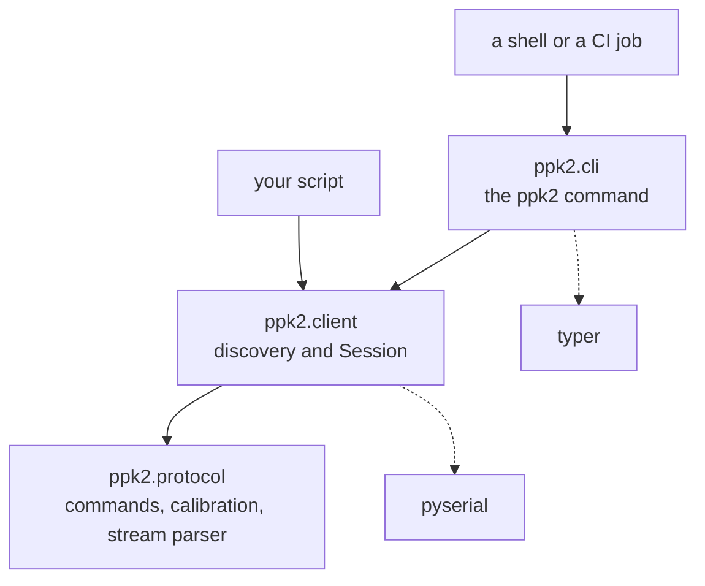
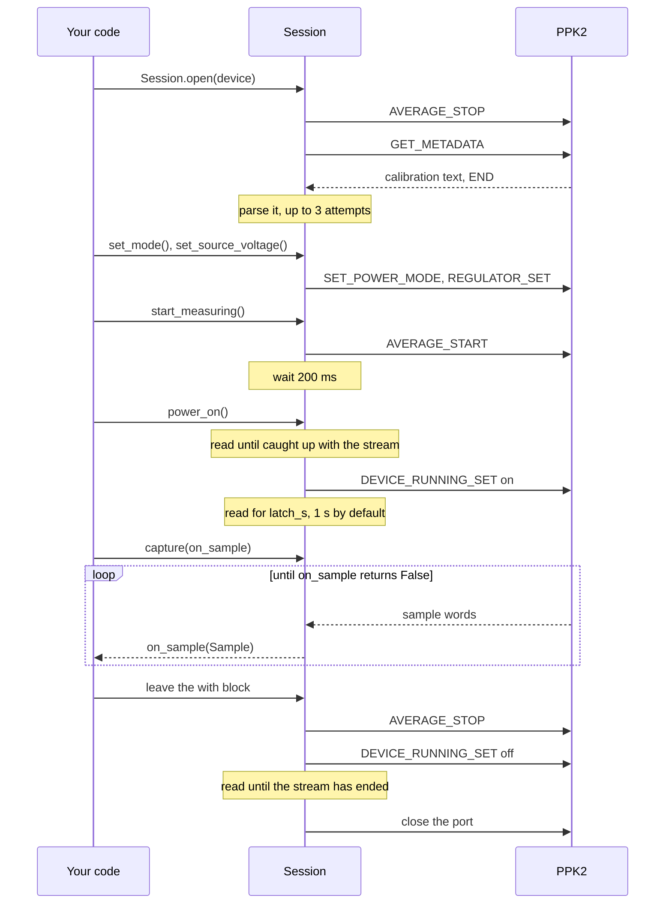
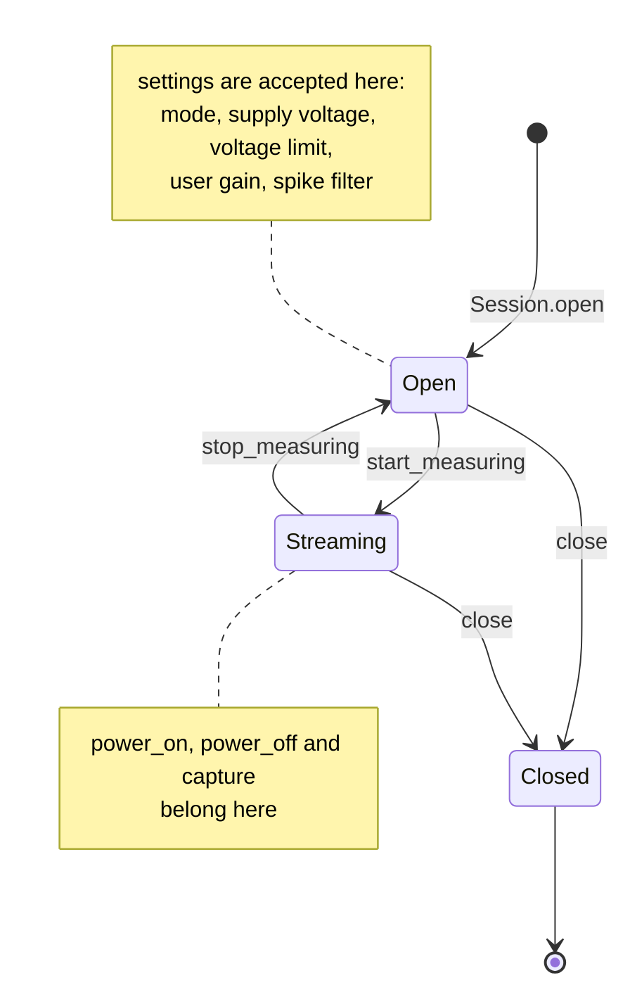

# Architecture

The `ppk2` package has three layers. Each one uses only the layer below
it, and each can be imported alone.

| Layer | What it does | Needs |
|---|---|---|
| `ppk2.protocol` | The bytes: commands, calibration text, sample decoding, calibration formula, stream parser. No input or output | Standard library |
| `ppk2.client` | The device: finds the PPK2 and runs a session on its serial port | `pyserial` |
| `ppk2.cli` | The [`ppk2` command](command.md): files, progress, signals, exit codes | `typer` |

The [API reference](api.md) lists what the first two contain.



Two things follow from this split:

- The protocol layer runs anywhere Python does. It can decode a saved
  stream in a notebook or a test, with no PPK2 and no serial port.
- The command line is one user of the client layer among others. What
  the command does, your script can do.

## Where the code is

```text
src/ppk2/
├── __init__.py          the public names, re-exported
├── protocol/            standard library only
│   ├── opcode.py        Opcode: the command bytes
│   ├── metadata.py      parse_metadata, CalibrationCoefficients
│   ├── sample.py        decode_sample, RawSample
│   ├── calibration.py   current_micro_amps: the formula
│   └── stream.py        StreamParser, Sample, SpikeFilter
├── client/              needs pyserial
│   ├── discovery.py     find_ppk2, list_ppk2s: which port is the PPK2
│   └── session.py       Session, Mode: open, configure, capture, close
└── cli/                 needs typer; internal, nothing is re-exported
    ├── main.py          the commands and the mapping of errors to exit codes
    ├── commands/        one module per command
    ├── csv.py           the app's CSV format
    ├── ppk2file.py      the app's .ppk2 session file
    ├── trace.py         the file a capture writes to, CSV or .ppk2
    └── signals.py       SIGTERM and SIGHUP end a session cleanly
```

The public interface of the command line is the command itself. Its
Python modules are internal and may change.

## The names you import

Everything meant for use is re-exported from `ppk2`:

```python
from ppk2 import Session, Mode, find_ppk2, list_ppk2s    # the device
from ppk2 import Sample, StreamParser, parse_metadata    # the bytes
from ppk2 import decode_sample, current_micro_amps, SpikeFilter
```

Importing from `ppk2.protocol` or `ppk2.client` gives the same
objects.

## A capture

Five seconds, with the samples kept in a list:

```python
from time import monotonic

from ppk2 import Mode, Session, find_ppk2

currents: list[float] = []

with Session.open(find_ppk2().device) as session:
    session.set_mode(Mode.AMPERE)
    session.set_source_voltage(3300)  # Ampere meter mode: only feeds the calibration
    session.start_measuring()
    session.power_on()
    deadline = monotonic() + 5.0

    def on_sample(sample) -> bool:
        currents.append(sample.current_micro_amps)
        return monotonic() < deadline

    session.capture(on_sample)

print(f"{len(currents)} samples, mean {sum(currents) / len(currents):.2f} µA")
```

```text
500736 samples, mean 697.73 µA
```

`capture` runs in the calling thread and calls your function for every
sample. It stops when the function returns `False`. Leaving the `with`
block stops the stream, switches the DUT off and closes the port, also
when the function raises. If the process is killed instead, the PPK2
cuts power by itself when the port closes.

## Life of a session

What your code calls, and what the session sends for it:



The states a session goes through:



Three details of this sequence are choices, not requirements of the
PPK2:

- The waits around `power_on` are precautions. The
  [known caveats](../measure/protocol.md#10-known-caveats) say where
  they come from. `ppk2 capture` and `ppk2 run` pass `latch_s=0.0`, so
  that the DUT's boot is in the trace.
- The session reads the stream to its end before it closes the port.
  Left unread, the end of one stream would greet the next program that
  opens the PPK2.
- No `RESET` is sent on close. It makes the PPK2 drop off USB and come
  back, which can block the next program.

`Session.open` tries three times in all, 0.5 s and then 1 s apart,
before it raises the last error: `HandshakeFailed` when the PPK2 did
not answer, `SerialIOError` when the port could not be opened.

A new session inherits two things. The PPK2 keeps its supply voltage
and its mode when a program disconnects, and `Session.open` reads both
back with the calibration. A PPK2 left in Source meter mode at 1800 mV
starts the next session there, until `set_mode` or
`set_source_voltage` says otherwise.

## The capture callback

```python
def on_sample(sample: Sample) -> bool:
    ...  # return True to go on, False to stop
```

`capture` calls your function for every sample and returns once it has
answered `False`. A function that always answers `True` never comes
back, so give it a way to stop: a deadline, or a number of samples.

The stop takes effect between two reads of the serial port, not
between two samples. One read brings up to 1,024 samples, and your
function is still called for the rest of that read after it answered
`False`. Write it so that this does no harm.

An exception raised in the function leaves `capture`, and the `with`
block still closes the session.

A lost sample arrives as a `Sample` whose current is NaN and whose
`logic` is 0. It keeps its place, so the count of samples still gives
the time. To be told as it happens, pass `on_dataloss`. It is called
with the total so far, at most once per read:

```python
def on_dataloss(total: int) -> None:
    print(f"{total} samples lost so far")


session.capture(on_sample, on_dataloss=on_dataloss)
```

## Settings of a session

The app has an advanced configuration panel with three groups of
settings. A session has the same ones, so a script can do what the
panel does. None is needed for an ordinary capture.

| In the app | In the library | On the command line |
|---|---|---|
| Spike filter, Samples to smooth | `Session.set_spike_filter(samples=...)` | none |
| Spike filter, Coefficient for range 1-4 | `Session.set_spike_filter(alpha=...)` | none |
| Spike filter, Coefficient for range 5 | `Session.set_spike_filter(alpha5=...)` | none |
| Gains, Range 1 to Range 5 | `Session.set_user_gain(range_idx, gain)` | `ppk2 capture --user-gain RANGE:GAIN` |
| Voltage limit, Set max supply voltage to | `Session.set_voltage_limit(mv)` | none |

Set them after `Session.open` and before `start_measuring`. While a
stream runs, all three raise `RuntimeError`: the capture has already
taken its settings. After `stop_measuring` they are accepted again.
None of them outlives the session: a new one starts from the defaults,
which are the app's.

The [measurement principle](../measure/principle.md#after-a-range-change-the-spike-filter)
says what the three numbers of the spike filter do.

### Gains

A gain multiplies every reading of one range. It is 1.0 unless you
change it. The app numbers the ranges 1 to 5; here they are 0 to 4, so
the app's Range 1 is `range_idx` 0.

```python
session.set_user_gain(2, 1.05)  # range 2 here, Range 3 in the app
```

```sh
ppk2 capture --out trace.csv --seconds 10 --user-gain 2:1.05 --user-gain 4:0.98
```

The gain is applied on the computer and nothing is sent to the PPK2.
Its firmware accepts the command for user gains and ignores it, and the
app also applies its gains on the computer.

### Voltage limit

A guard for Source meter mode. Some DUTs do not survive 5 V, and a
typing mistake should not cost one.

```python
from ppk2 import Mode, Session, find_ppk2

with Session.open(find_ppk2().device) as session:
    session.set_mode(Mode.SOURCE)
    session.set_voltage_limit(3300)
    session.set_source_voltage(3300)  # accepted
    session.set_source_voltage(3600)  # raises ValueError
```

The limit itself is kept between 800 and 5,000 mV, the range of the
PPK2. Lowering it does not lower a supply voltage that is already
higher: call `set_source_voltage` again for that.

## Threads

Use one `Session` from one thread. The serial port underneath is not
safe to share, and the session adds no lock: two threads reading it
would each get pieces of the stream.

An ordinary capture needs no thread at all. The callback runs in the
thread that called `capture`.

`ppk2 run` is the one place where this package starts a thread. It
reads the stream in a second thread while it waits for the command, and
touches the session again only once that thread has ended.

You need a second thread only to feed several consumers at once, for
instance a file and a live plot. Let one thread own the session and put
the samples on a queue:

```python
import queue
import threading

from ppk2 import Mode, Session, find_ppk2

samples: queue.Queue = queue.Queue(maxsize=10_000)
stop = threading.Event()


def producer() -> None:
    with Session.open(find_ppk2().device) as session:
        session.set_mode(Mode.AMPERE)
        session.set_source_voltage(3300)
        session.start_measuring()
        session.power_on()
        session.capture(lambda sample: (samples.put(sample), not stop.is_set())[-1])


thread = threading.Thread(target=producer)
thread.start()
got = [samples.get() for _ in range(50_000)]  # half a second of samples
stop.set()
while thread.is_alive():  # keep the queue moving until the producer has left
    try:
        samples.get(timeout=0.1)
    except queue.Empty:
        pass
thread.join()
print(len(got), "samples in the consumer")
```

A `Sample` cannot be modified, so consumers can share it. The producer
is the only thread that touches the session.

## Choices behind the design

- Synchronous. A session owns one serial port and one stream. An
  asynchronous interface would add ceremony and buy nothing here.
- A callback per sample. The caller decides what to keep, so a capture
  of any length runs in constant memory.
- Values that cannot change. `Sample`, `RawSample`,
  `CalibrationCoefficients` and `SpikeFilter` are frozen dataclasses.
- Errors with a type. Discovery raises `DiscoveryError`, a session
  raises `SessionError`, the calibration parser raises `MetadataError`,
  each with subclasses for the cases worth telling apart.
- Checked statically. The package passes pyright in strict mode and
  ships its type information.
- The same result as Nordic's app. The parser, the spike filter and the
  file formats follow the app, so that a capture made here can be laid
  over one made there. The [validation](../validation/results.md) shows
  how far that holds.

## Read on

- [API reference](api.md)
- [Measurement principle](../measure/principle.md) and
  [protocol](../measure/protocol.md): what the numbers are, and how the
  PPK2 behaves.
