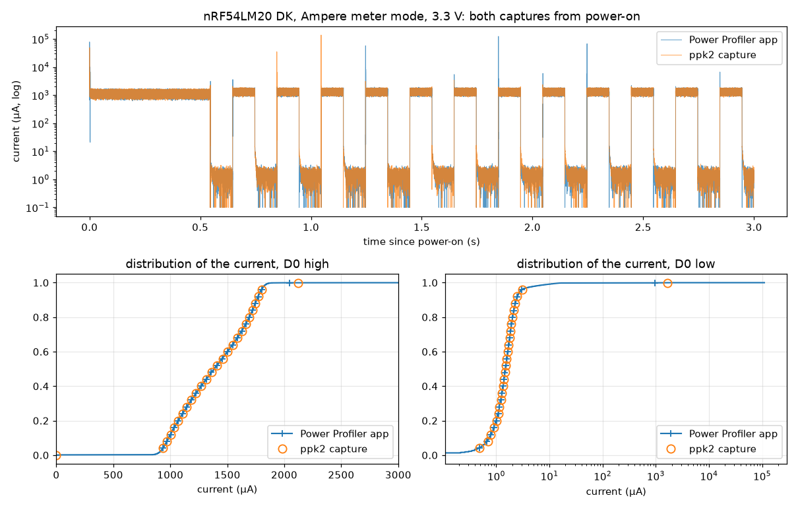
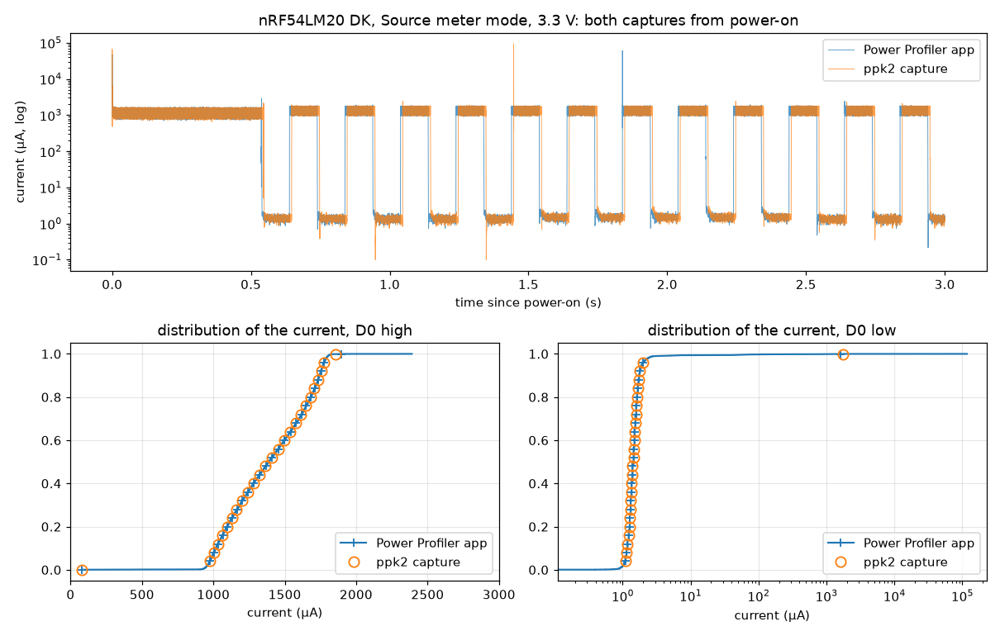

# Results

What the three levels of the [method](method.md) found. The parser,
the calibration and the start of a capture are those of this release.
[Hardware tests](#hardware-tests) lists what changed after the
captures.

| Level | Result | Run on |
|---|---|---|
| The parser, 600 samples | Every current equal to three decimals, every digital byte identical | The current code |
| Captures in Ampere meter mode | Mean current and mean charge of the marked regions within 0.11 % of the app's | 2026-11-21 |
| Captures in Source meter mode | Mean current and mean charge of the marked regions within 0.04 % of the app's | 2026-11-21 |
| The 0.2 µA floor | No value between 0 and 0.2 µA, in either tool | 2026-11-21 |
| A `.ppk2` file opened in the app | Loads; average, maximum and charge of a 10 s window equal to those of the CSV | 2026-11-21 |
| Ten hardware tests | All pass | 2026-11-21 in both modes, 2026-11-22 in Source meter mode |

## Parser

On the 600 recorded samples, this package and the app's parser give
the same current to three decimals for every sample, and the same
digital inputs. The stream crosses all five measurement ranges, so the
calibration of each range and the spike filter are part of what agrees.

## Captures

The device under test (DUT) is an nRF54LM20 DK that runs the
[bench firmware](https://github.com/rdagher/ppk2-lib/tree/main/tests/hil/bench-dut):
D0 toggles at 5 Hz and D1 at 0.5 Hz, and the CPU is busy while D0 is
high. The bench was captured for 30 s by the app and by `ppk2 capture`,
within minutes of each other and without being touched in between.

| Item | Value |
|---|---|
| Date | 2026-11-21, between 19:31 and 19:40 |
| PPK2 | One unit, firmware 1.2.4 (`db16a94`), the version the app installs. Its calibration text is in the evidence folder |
| App | Power Profiler 4.4.1, in [nRF Connect for Desktop](https://www.nordicsemi.com/Software-and-Tools/Development-Tools/nRF-Connect-for-desktop) 5.4.1 |
| This package | Commit `ace11d0`, with Python 3.13.13 and [pyserial](https://pyserial.readthedocs.io/) 3.5 |
| Host | macOS 26.5.1 |
| DUT | nRF54LM20 DK with the bench firmware |
| Captures | 30 s each at 100,000 samples per second. Those of `ppk2 capture` start at power-on, the app's about 0.7 s before it |

The current of a region is its mean current, and its charge is that
current added up over its width. Each is given as the mean ± the
standard deviation over the regions. A difference is that of the means,
as a share of the app's, computed before rounding. The KS statistic
compares the distributions of the current over the same 26 s, starting
2 s after power-on.

### Ampere meter mode, 3.3 V

The app's capture was taken between two of `ppk2 capture`.

| | App (19:34) | `ppk2 capture` (19:31) | `ppk2 capture` (19:35) |
|---|---|---|---|
| D0 regions | 143 | 147 | 147 |
| Current of a D0 region | 1,380.4 ± 1.8 µA | 1,381.6 ± 2.0 µA | 1,380.9 ± 1.6 µA |
| Charge of a D0 region | 138.02 ± 0.18 µC | 138.14 ± 0.20 µC | 138.07 ± 0.16 µC |
| D1 regions | 14 | 14 | 14 |
| Current of a D1 region | 699.3 ± 2.6 µA | 699.9 ± 3.0 µA | 700.1 ± 2.6 µA |
| Charge of a D1 region | 699.3 ± 2.6 µC | 699.9 ± 3.0 µC | 700.1 ± 2.6 µC |
| Idle median | 1.40 µA | 1.40 µA | 1.40 µA |
| Difference from the app, D0 current and charge | | 0.09 % | 0.04 % |
| Difference from the app, D1 current and charge | | 0.09 % | 0.11 % |
| KS statistic against the app | | 0.0037 | 0.0032 |

A D1 region lasts one second, so its charge in µC has the figures of
its current in µA. The two captures of `ppk2 capture` differ from each
other by 0.05 % on the D0 current. So the difference from the app is of the size of the
bench's own drift over four minutes.



### Source meter mode, 3.3 V

Here both captures of `ppk2 capture` follow the app's.

| | App (19:38) | `ppk2 capture` (19:38) | `ppk2 capture` (19:39) |
|---|---|---|---|
| D0 regions | 143 | 147 | 147 |
| Current of a D0 region | 1,385.92 ± 0.82 µA | 1,385.4 ± 1.0 µA | 1,385.64 ± 0.79 µA |
| Charge of a D0 region | 138.570 ± 0.087 µC | 138.52 ± 0.11 µC | 138.541 ± 0.086 µC |
| D1 regions | 14 | 14 | 14 |
| Current of a D1 region | 700.9 ± 2.8 µA | 700.7 ± 1.8 µA | 700.8 ± 2.2 µA |
| Charge of a D1 region | 700.9 ± 2.8 µC | 700.7 ± 1.8 µC | 700.9 ± 2.2 µC |
| Idle median | 1.35 µA | 1.35 µA | 1.35 µA |
| Difference from the app, D0 current and charge | | 0.04 % | 0.02 % |
| Difference from the app, D1 current and charge | | 0.03 % | 0.00 % |
| KS statistic against the app | | 0.0034 | 0.0056 |



### The 0.2 µA floor

The app records any current below 0.2 µA as zero, and so must
`ppk2 capture`. Over the whole of each capture, the unpowered start
included:

| | App | `ppk2 capture` 1 | `ppk2 capture` 2 |
|---|---|---|---|
| Ampere meter: values between 0 and 0.2 µA | 0 | 0 | 0 |
| Ampere meter: negative values | 0 | 0 | 0 |
| Ampere meter: lowest value above zero | 0.204 µA | 0.201 µA | 0.201 µA |
| Source meter: values between 0 and 0.2 µA | 0 | 0 | 0 |
| Source meter: negative values | 0 | 0 | 0 |
| Source meter: lowest value above zero | 0.215 µA | 0.215 µA | 0.215 µA |

## Session file

A 30 s capture in Source meter mode at 3.3 V was converted with
`ppk2 convert` and loaded in the app. For the last 10 s of the trace:

| | The app, from the `.ppk2` file | Computed from the CSV |
|---|---|---|
| Average | 699.32 µA | 699.32 µA |
| Maximum | 171.80 mA | 171.80 mA |
| Charge | 6.99 mC | 6.993 mC |
| D0 pulses | 50 | 50 |
| D1 pulses | 5 | 5 |

The trace ends at 30.00319 s in both. This checks that the app reads
what `ppk2` writes. The two files are not in the repository: the CSV is
123 MB.

## Hardware tests

All ten pass, at 3.3 V on an nRF54LM20 DK. They were run in both modes
on 2026-11-21, on the code of the captures above. After that the way a
capture ends and the handling of errors changed: a capture now stops
on its count of samples, and fails when they do not all come. The ten
were run again on the code of this release on 2026-11-22, in Source
meter mode. The parser, the calibration and the start of a capture,
which the captures above check, did not change.

One more check was made by hand: a running capture was frozen for 3 s,
which makes the computer lose samples. Three such captures recovered,
with 18 to 34 samples marked lost and normal currents afterwards. The
[protocol page](../measure/protocol.md#5-stream-reassembly) says how
the parser finds its place again.

## Differences from the app

On purpose, and outside what the comparisons above exercise:

- Lost samples. The app's code duplicates held samples, counts a lost
  gap one short, and places the samples received after a gap before
  it. This package emits each sample once, counts the full gap, and
  keeps the order. The
  [protocol page](../measure/protocol.md#5-stream-reassembly)
  has the five points with their line references. Both record a lost
  sample as 0.2 µA.
- Where a capture starts. In the app you start the capture and enable
  power by hand. `ppk2 capture` does both, and its file begins about
    10 ms before the power comes up.

## Limitations

- The bench: one PPK2 and one dev kit, on a Mac. The package runs on
  Linux and Windows too, where its unit tests pass, but no capture was
  compared with the app there.
- The reference is the app. Agreement with it says nothing about the
  absolute accuracy of the PPK2, which Nordic gives as better than
  ±20 %.
- Each capture lasts 30 s. Longer captures were not compared.

## Reproducing the results

The captures and the scripts are in
[`validation/evidence/bench_dut/`](https://github.com/rdagher/ppk2-lib/tree/main/validation/evidence/bench_dut),
the recording and its reference in
[`tests/fixtures/`](https://github.com/rdagher/ppk2-lib/tree/main/tests/fixtures).
From a checkout:

```sh
# the parser against the stored reference
just test

# the six captures, from the branch `captures` of the repository (42 MB)
just captures

# the tables above, from those captures
uv run --group validation python validation/evidence/bench_dut/summary.py

# the plots above
just plots

# current and charge per marked region of one capture
python validation/regions.py validation/evidence/bench_dut/captures/source_app.csv.xz

# two captures of your own bench
uv run --group validation python -m validation.compare_cli app.csv ours.csv --skip-initial-s 2
```
