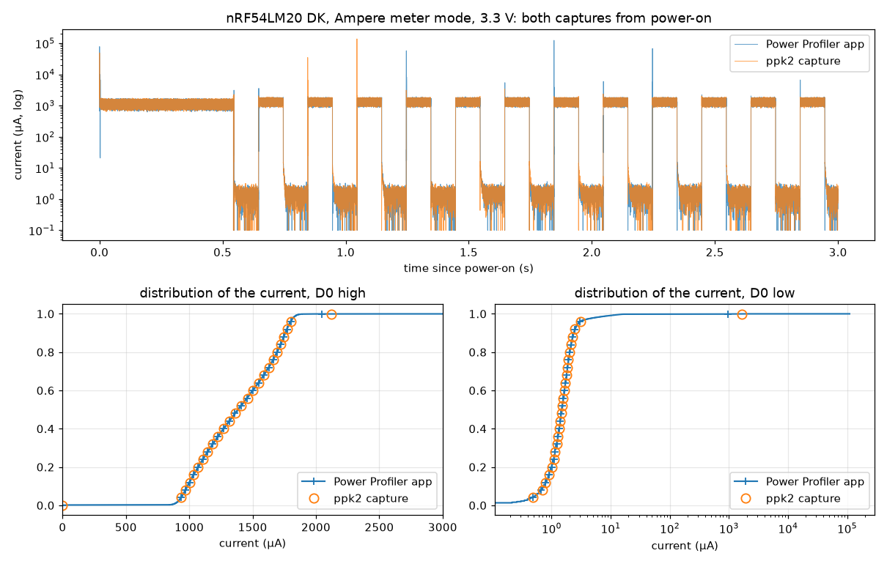
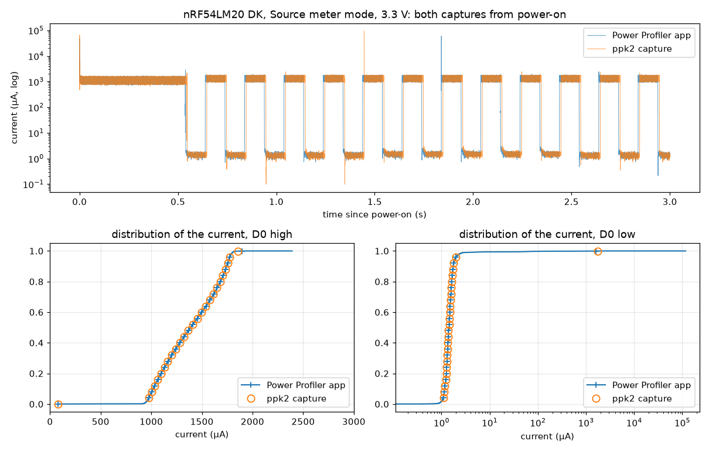

# Round of 2026-11-21: the app against `ppk2 capture`

One bench, captured by Nordic's Power Profiler app and by
`ppk2 capture` within minutes of each other, in both modes. The
[results page](../../../docs/validation/results.md) of the
documentation discusses the numbers; this folder holds what they come
from.

## Setup

| | |
|---|---|
| Date | 2026-11-21, between 19:31 and 19:40 |
| PPK2 | One unit, firmware 1.2.4 (`db16a94`), the version the app installs. Its calibration text is in [`ppk2_metadata.txt`](ppk2_metadata.txt) |
| App | Power Profiler 4.4.1, in nRF Connect for Desktop 5.4.1 |
| This package | Commit `ace11d0`, with Python 3.13.13 and pyserial 3.5 |
| Host | macOS 26.5.1 |
| DUT | nRF54LM20 DK with the [bench firmware](../../../tests/hil/bench-dut/): D0 toggles at 5 Hz, D1 at 0.5 Hz, and the CPU is busy while D0 is high |
| Captures | 30 s each at 100,000 samples per second, starting at power-on |

In Ampere meter mode the app's capture was taken between the two of
`ppk2 capture`, so that the difference between those two shows how much
the bench moved by itself. In Source meter mode both captures of
`ppk2 capture` follow the app's.

In the app: Start, then Enable power output, then Save / Export to CSV
with the timestamp, the current and the digital inputs.

## Ampere meter mode, 3.3 V

| | App (19:34) | `ppk2 capture` (19:31) | `ppk2 capture` (19:35) |
|---|---|---|---|
| D0 regions | 143 | 147 | 147 |
| Current of a D0 region | 1380.4 ± 1.8 µA | 1381.6 ± 2.0 µA | 1380.9 ± 1.6 µA |
| Charge of a D0 region | 138.02 ± 0.18 µC | 138.14 ± 0.20 µC | 138.07 ± 0.16 µC |
| D1 regions | 14 | 14 | 14 |
| Current of a D1 region | 699.3 ± 2.6 µA | 699.9 ± 3.0 µA | 700.1 ± 2.6 µA |
| Idle median | 1.40 µA | 1.40 µA | 1.40 µA |
| Difference from the app, D0 current | | 0.09 % | 0.04 % |
| Difference from the app, D1 current | | 0.09 % | 0.11 % |
| KS statistic against the app | | 0.0037 | 0.0032 |



## Source meter mode, 3.3 V

| | App (19:38) | `ppk2 capture` (19:38) | `ppk2 capture` (19:39) |
|---|---|---|---|
| D0 regions | 143 | 147 | 147 |
| Current of a D0 region | 1385.92 ± 0.82 µA | 1385.4 ± 1.0 µA | 1385.64 ± 0.79 µA |
| Charge of a D0 region | 138.57 ± 0.09 µC | 138.52 ± 0.11 µC | 138.54 ± 0.09 µC |
| D1 regions | 14 | 14 | 14 |
| Current of a D1 region | 700.9 ± 2.8 µA | 700.7 ± 1.8 µA | 700.9 ± 2.2 µA |
| Idle median | 1.35 µA | 1.35 µA | 1.35 µA |
| Difference from the app, D0 current | | 0.04 % | 0.02 % |
| Difference from the app, D1 current | | 0.03 % | 0.00 % |
| KS statistic against the app | | 0.0034 | 0.0056 |



The current of a region is its mean current, and its charge is that
current added up over its width. Each is given as the mean ± the
standard deviation over the regions. A difference is that of the means,
as a share of the app's, computed before rounding. The KS statistic
compares the distributions of the current over the same 26 s, starting
2 s after power-on.

## The 0.2 µA floor

The app records any current below 0.2 µA as zero, and so must
`ppk2 capture`. Over the whole of each capture, the unpowered start
included:

| | App | `ppk2 capture` 1 | `ppk2 capture` 2 |
|---|---|---|---|
| Ampere meter: values between 0 and 0.2 µA | 0 | 0 | 0 |
| Ampere meter: negative values | 0 | 0 | 0 |
| Ampere meter: lowest value above zero | 0.204 µA | 0.201 µA | 0.201 µA |
| Source meter: values between 0 and 0.2 µA | 0 | 0 | 0 |
| Source meter: negative values | 0 | 0 | 0 |
| Source meter: lowest value above zero | 0.215 µA | 0.215 µA | 0.215 µA |

## Files

| File | Content |
|---|---|
| `captures/<mode>_app.csv.xz` | The app's export |
| `captures/<mode>_ppk2_1.csv.xz`, `captures/<mode>_ppk2_2.csv.xz` | The two captures of `ppk2 capture` |
| `ppk2_metadata.txt` | The output of `ppk2 metadata` on the PPK2 used |
| `summary.py`, `summary.txt` | The script that prints the tables above, and what it printed |
| `make_plots.py`, `plots/` | The script that draws the plots, and the plots. `wakeup.png` shows two wake-ups, one with readings the spike filter left in |

## Run it again

```sh
uv run --group validation python validation/evidence/bench_dut/summary.py
just plots
python validation/regions.py validation/evidence/bench_dut/captures/source_app.csv.xz
```

`summary.py` takes a few minutes: it reads 18 million rows. `just plots`
redraws both figures with the versions fixed in `uv.lock`.
